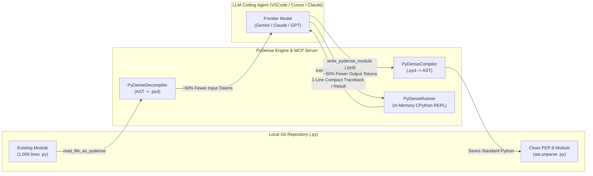

# ⚡ PyDense (`.pyd`)

**The AI-Native, Zero-Whitespace Python Interface & MCP Server for Coding Agents.**  
*100% Python AST Isomorphism · ~50% Fewer BPE Tokens · 2x Faster Agent Code Generation · Zero Dependencies*

[](https://www.python.org/)
[](https://modelcontextprotocol.io/)
[](LICENSE)

---

## Why PyDense Exists

Programming languages were designed for human eyes, biological working-memory limits, and manual typing. When AI agents write code for machines to execute, human syntactic sugar—indentation blocks, verbose keywords (`def`, `return`, `isinstance`), repetitive `self.` prefixes, and standard library imports—acts as an **expensive, high-entropy tax**.

However, inventing an alien language from scratch breaks an LLM's deepest reasoning weights, which are heavily entangled with **Python's Abstract Syntax Tree (AST)** and ecosystem (`numpy`, `pandas`, `asyncio`, `dataclasses`).

**PyDense (`.pyd`) solves both problems:**
1. **1-to-1 Python AST Bijection:** Every PyDense construct maps deterministically to a native Python `ast.AST` node and executes directly on the CPython runtime in under `0.5 ms`.
2. **BPE Tokenizer-Aligned Grammar:** Punctuation-prefixed operators (`@c`, `@f`, `@i`, `?`, `~`, `^`, `#np`, `%l`) prevent adjacent identifiers from merging into fragmented byte tokens while eliminating mandatory whitespace and indentation bugs.
3. **"Write Dense, Commit Clean" Hybrid MCP Workflow:** Your IDE agent reads large files compressed into `.pyd` (cutting input context by ~50%) and emits `.pyd` inside tool calls (cutting output latency and cost in half), while the local MCP server automatically transpiles and writes clean, PEP-8 formatted `.py` to disk. Your git history stays 100% standard Python.

---

## Side-by-Side Comparison

```python
# --- STANDARD PYTHON (158 o200k_base tokens | 594 chars) ---
import math
from dataclasses import dataclass

@dataclass(frozen=True)
class MarketQuote:
    bid_price: float
    ask_price: float
    reservation_price: float
    half_spread: float

def compute_optimal_quotes(
    mid_price: float,
    inventory: float,
    gamma: float = 0.1,
    volatility: float = 0.02,
    horizon: float = 1.0,
    kappa: float = 1.5,
) -> MarketQuote:
    variance = (volatility ** 2) * horizon
    res_price = mid_price - (inventory * gamma * variance)
    spread = gamma * variance + (2.0 / gamma) * math.log(1.0 + (gamma / kappa))
    half = spread / 2.0
    return MarketQuote(res_price - half, res_price + half, res_price, half)
```

```text
// --- PYDENSE EQUIVALENT (79 o200k_base tokens | 265 chars | 50.0% Token Reduction) ---
@#dc(frozen=#T)@c MarketQuote{bid_price:float;ask_price:float;reservation_price:float;half_spread:float};@f compute_optimal_quotes(mid_price,inventory,gamma=0.1,volatility=0.02,horizon=1.0,kappa=1.5){variance=$3**2*$4;res_price=$0-$1*$2*variance;spread=$2*variance+2.0/$2*#m.log(1.0+$2/$5);half=spread/2.0;^MarketQuote(res_price-half,res_price+half,res_price,half)}
```

---

## Architecture: The "Invisible Transpiler" Workflow



---

## Benchmarks (`o200k_base` & `cl100k_base`)

Measured using `benchmarks/token_compression.py` across 5 production workloads (classes, numerical computing, dataclasses, `asyncio` pipelines, decorators, and `*args`/`**kwargs` unpacking):

| Workload | Python Tokens (`o200k`) | PyDense Typed (`.pyd`) | PyDense Stripped (`.pyd`) | Token Reduction | AST Compile Time |
| :--- | :---: | :---: | :---: | :---: | :---: |
| **1. Rolling EWMA & Volatility Tracker** | 184 | 110 (-40.2%) | **96** | **-47.8%** | 0.42 ms |
| **2. Covariance Shrinkage & Inv-Vol Weights** | 169 | 103 (-39.1%) | **91** | **-46.2%** | 0.38 ms |
| **3. Avellaneda-Stoikov Quote Calculator** | 158 | 102 (-35.4%) | **79** | **-50.0%** | 0.35 ms |
| **4. Async Batch Fetcher & Error Recovery** | 146 | 93 (-36.3%) | **81** | **-44.5%** | 0.33 ms |
| **5. Decorator Retry & Config Unpacker** | 149 | 98 (-34.2%) | **77** | **-48.3%** | 0.31 ms |
| **TOTAL / AVERAGE** | **806** | **506 (-37.2%)** | **424** | **-47.4%** | **0.36 ms** |

* **Secondary Tokenizer (`cl100k_base`):** `830` Python tokens $\rightarrow$ `436` PyDense tokens (**-47.5% reduction**).
* **Traceback Compression:** Standard 12-line Python tracebacks (~240 tokens) compress to single-line diagnostics (~18 tokens):
  ```text
  !Err[calc_log_sharpe:L3]: ValueError(Need at least 2 prices)
  ```

---

## Quickstart (Under 2 Minutes)

### 1. Clone & Install
PyDense runs out-of-the-box on **Python 3.10+** with **zero required dependencies**.

```bash
git clone https://github.com/your-org/pydense.git
cd pydense
pip install -e .

# Optional: Install tiktoken for benchmarking and FastMCP SDK
pip install -e ".[dev]"
```

### 2. Verify Compiler & Run Benchmarks
```bash
# Run the built-in compiler, decompiler, unpacking & async verification suite
pydense test

# Run the BPE token compression & latency benchmark
python3 benchmarks/token_compression.py
```

### 3. Enable in Any Project Workspace
Navigate to any Python project and run `init-skill` to auto-generate `SKILL.md`, `.cursorrules`, `CLAUDE.md`, and `.vscode/mcp.json`:

```bash
cd /path/to/your/project
pydense init-skill .
```

---

## Connecting to VSCode, Cursor & Claude Code

### Claude Code (CLI)
Register the MCP server globally or per-project with a single command:

```bash
claude mcp add pydense -- python3 /absolute/path/to/pydense/mcp_server.py
```

### VSCode (GitHub Copilot Agent / Cline / Roo) & Cursor
Running `pydense init-skill .` automatically creates `.vscode/mcp.json` (copy to `.cursor/mcp.json` for Cursor):

```json
{
  "mcpServers": {
    "pydense": {
      "command": "python3",
      "args": ["/absolute/path/to/pydense/mcp_server.py"],
      "env": {
        "PYTHONUNBUFFERED": "1"
      }
    }
  }
}
```

### Exposed MCP Tools

| Tool Name | Purpose | Token Impact |
| :--- | :--- | :--- |
| `execute_pydense` | Runs `.pyd` code in a stateful, Jupyter-style in-memory Python REPL session and returns the final expression + compact errors. | **~50% fewer output tokens** during iterative agent testing. |
| `write_pydense_module` | Accepts compact `.pyd` from the agent, transpiles to a Python AST, and writes PEP-8 formatted `.py` to disk (`output_format="py"`). | **~50% faster file generation** while keeping git commits 100% standard Python. |
| `read_file_as_pydense` | Reads an existing `.py` file from disk and compresses it into `.pyd` on the fly. | **~50% fewer input tokens** when loading large modules into context. |
| `transpile_preview` | Converts strings back and forth between `.pyd` and `.py` without disk I/O. | Instant human auditing or test generation. |
| `get_pydense_skill_spec` | Returns the `<500-token` grammar & macro cheat sheet on demand. | Zero permanent system-prompt bloat. |

---

## CLI Usage

```bash
# Execute inline PyDense code directly
pydense -c "@f fib(n:int)->int{^$0<=1??$0:fib($0-1)+fib($0-2)};%p([fib(i)~i:%r(10)])"

# Run a .pyd script file
pydense run examples/ewma.pyd

# Compress an existing Python file into .pyd (with optional --strip-types)
pydense decompile src/portfolio.py -o src/portfolio.pyd --strip-types

# Expand a .pyd file into clean, PEP-8 formatted Python
pydense compile src/portfolio.pyd -o src/portfolio_clean.py
```

---

## PyDense (`.pyd`) Language Reference

### 1. Structural & Control Flow Syntax

| Construct | Standard Python (`.py`) | PyDense (`.pyd`) |
| :--- | :--- | :--- |
| **Blocks & Statements** | Indentation + newlines | `{stmt1;stmt2}` (no `;` needed after `}`) |
| **Class Definition** | `class A(B):` | `@c A(B){...}` |
| **Constructor (`__init__`)** | `def __init__(self, x=1):` | `@i(x=1){...}` (`self` is implicit) |
| **Methods & Functions** | `def fn(a: int) -> int:` | `@f fn(a:int)->int{...}` (`@af` async, `@sf` static) |
| **Decorators** | `@dec1` / `@dec2(10)` | `@dec1@dec2(10)@f fn(){...}` or `@[dec1,dec2(10)]` |
| **Self Attributes** | `self.alpha = 0.5` | `.alpha=0.5` |
| **Positional Parameters** | `a + b * c` (1st, 2nd, 3rd params) | `$0+$1*$2` |
| **If / Elif / Else** | `if c1: ... elif c2: ... else: ...` | `?c1{...}:?c2{...}:{...}` |
| **Ternary Expression** | `x if cond else y` | `cond??x:y` |
| **For / Async For Loop** | `for x in items:` / `async for` | `~x:items{...}` / `~@x:items{...}` |
| **While Loop** | `while cond:` | `~?cond{...}` |
| **Try / Except / Finally** | `try: ... except E as e: ... finally: ...` | `!{...}!E:e{...}!*{...}` |
| **With / Async With** | `with open(p) as f:` | `@w %o(p):f{...}` / `@wa ctx():c{...}` |
| **List / Dict Comp** | `[x*2 for x in it if x>0]` | `[x*2~x:it?x>0]` / `{k:v~k,v:it?c}` |
| **Lambda** | `lambda a, b: a + b` | `\a,b:a+b` |
| **Return / Yield / Raise** | `return x` / `yield x` / `raise e` | `^x` / `^>x` / `^@e` |
| **Break / Continue / Await** | `break` / `continue` / `await x` | `^!` / `^~` / `@aw x` |
| **Boolean & Identity Ops** | `and`, `or`, `not`, `in`, `is`, `is not` | `&&`, `||`, `!`, `@in`, `@is`, `!@is` |
| **Imports** | `import pkg as p` / `from m import a` | `>pkg=p` / `>m:a` |

### 2. Pre-Bound 1-Token Macros (Auto-Imported on Use)

* **Constants:** `#T` (`True`), `#F` (`False`), `#N` (`None`)
* **Ecosystem Libraries:** `#np` (`numpy`), `#pd` (`pandas`), `#sp` (`scipy`), `#os` (`os`), `#sys` (`sys`), `#js` (`json`), `#re` (`re`), `#m` (`math`), `#dt` (`datetime`), `#pl` (`pathlib.Path`), `#as` (`asyncio`), `#dc` (`dataclasses.dataclass`)
* **Builtins:** `%p` (`print`), `%l` (`len`), `%r` (`range`), `%e` (`enumerate`), `%z` (`zip`), `%s` (`sum`), `%m` (`map`), `%f` (`filter`), `%d` (`dict`), `%li` (`list`), `%st` (`set`), `%t` (`type`), `%i` (`isinstance`), `%a` (`abs`), `%mn` (`min`), `%mx` (`max`), `%rd` (`round`), `%o` (`open`)

---

## Repository Layout

```text
pydense/
├── pydense.py                   # Core Lexer, AST Compiler, Decompiler & Runner
├── mcp_server.py                # Dual-engine MCP Server (FastMCP + Zero-Dep Stdio)
├── pydense_cli.py               # CLI (`pydense`) & Workspace Skill Installer
├── grammar.lark                 # Formal EBNF Grammar Specification
├── SKILL.md                     # <500-token System Prompt for Coding Agents
├── benchmarks/
│   └── token_compression.py     # BPE Tokenizer & AST Latency Benchmark Suite
└── pyproject.toml               # Package Configuration & Entrypoints
```

## License

Released under the [MIT License](LICENSE).
